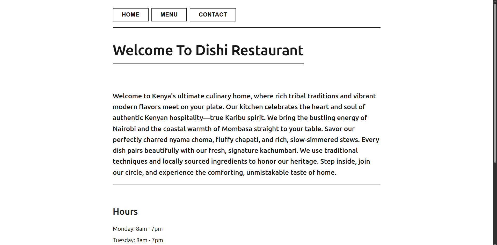

# Dishi Restaurant Page

A small restaurant website for **Dishi Restaurant**, featuring Kenyan-inspired food and hospitality. The page is built with vanilla JavaScript and Webpack. Its Home, Menu, and Contact views are rendered dynamically without reloading the page.

## Screenshot



## Features

- Navigate between Home, Menu, and Contact views using the top navigation.
- View the restaurant introduction, opening hours, and location.
- Browse beverages, sides, and main dishes with descriptions and prices in Kenyan shillings.
- Find contact details for the restaurant team.

## Built with

- HTML
- CSS
- JavaScript (ES modules)
- Webpack and webpack-dev-server

## Getting started

You’ll need [Node.js](https://nodejs.org/) and npm installed.

1. Clone the repository and move into the project directory:

   ```bash
   git clone https://github.com/Myth254/Odin-Project-Restaurant-Page.git
   cd Odin-Project-Restaurant-Page
   ```

2. Install dependencies:

   ```bash
   npm install
   ```

3. Start the development server:

   ```bash
   npx webpack serve
   ```

   Open the local URL printed by webpack-dev-server in your browser.

## Production build

Build the site into the `dist/` directory with:

```bash
npx webpack
```

## Project structure

```text
src/
├── contact.js       # Contact view and team details
├── home.js          # Home view, opening hours, and location
├── index.js         # Entry point and view navigation
├── menu.js          # Menu view and menu data
├── styles.css       # Site styles
└── template.html    # HTML template used by HtmlWebpackPlugin
webpack.config.js    # Webpack and development server configuration
```

## Notes

This project was created as part of The Odin Project’s JavaScript curriculum. A test script is not currently configured in `package.json`.
